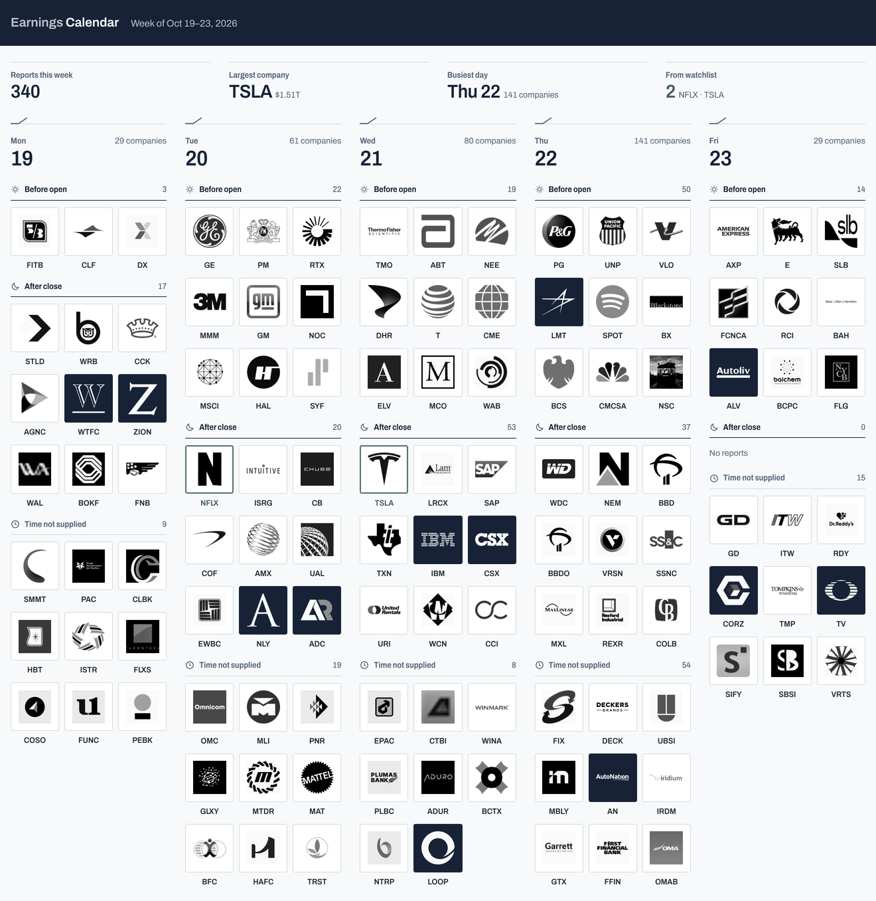

# Earnings Calendar

A weekly calendar of US earnings reports shown as company logos, modelled on the
[Yahoo Finance Earnings Calendar](https://finance.yahoo.com/calendar/earnings/) but set in the same design system
as [Option Toolkit](https://github.com/z0zqa/opcje): a midnight-navy band, a light working ground, rules instead of
cards, eucalyptus as the only accent, Archivo with tabular figures, and a dark theme that follows the system.
Every Sunday an email arrives with a summary of the coming week and a screenshot of the app.



## What the app shows

- Five columns (Mon–Fri), each split into **Before open**, **After close** and **Time not supplied**.
- The 9 largest companies by market cap per session by default; the rest sit behind "+ N more".
- Logos in monochrome, in colour on hover or with the **Color** toggle.
- Click a company for market cap, EPS consensus, EPS a year ago, change y/y, fiscal quarter and number of estimates.
- Watchlist companies get a eucalyptus outline; a **Watchlist** filter, search, and ← → keys to change week.
- Opens straight from disk (`index.html`) and works on a phone.

Data: Nasdaq's public earnings-calendar API (no key). Logos: Financial Modeling Prep, then Parqet, then a
monogram of the ticker when neither has one.

## Run locally

```bash
npm install
npm run fetch        # one week back + three weeks ahead into data/
open index.html      # or: npm start → http://localhost:4321
npm run digest:dry   # builds the email and screenshot into out/ without sending
```

## Configuration (`config.json`)

| Field | Meaning |
| --- | --- |
| `perSession` | logos per session before "+ N more" |
| `watchlist` | tickers highlighted in the app and the email |
| `weeksBack`, `weeksAhead` | how far to fetch |
| `keepWeeks` | how many weeks of history to keep in `data/` |

Run `npm run fetch` after a change (it also regenerates `config.js` for the browser).

## Sunday email

The **Sunday email** workflow (`.github/workflows/weekly-digest.yml`) runs on Sundays at 16:07 UTC: it fetches
fresh data, screenshots the coming week with Playwright and sends the email over SMTP. The email has the number
of reports, the companies on your watchlist, the 10 largest companies, a day-by-day overview and the calendar
screenshot (inline and attached).

Set these under **Settings → Secrets and variables → Actions**:

| Secret | Value |
| --- | --- |
| `SMTP_USER` | the Gmail address that sends the email |
| `SMTP_PASS` | a [Google app password](https://myaccount.google.com/apppasswords) (needs 2-step verification), not your normal password |
| `MAIL_TO` | recipient (optional; defaults to `SMTP_USER`) |

Optional variables: `APP_URL` for the "Open the app" link in the email; `SMTP_HOST` / `SMTP_PORT` for a server
other than Gmail.

To test: **Actions → Sunday email → Run workflow** ("Build the email only" leaves the result in the `digest`
artifact).

Scheduled GitHub Actions only run on the default branch (`main`).

## Publishing (optional)

`pages.yml` deploys the app to GitHub Pages after each data refresh. Turn on Pages (Source: GitHub Actions) and
set the variable `PAGES_ENABLED=true`. Pages on a private repository needs GitHub Pro; without it the app runs
locally and the email still arrives.
