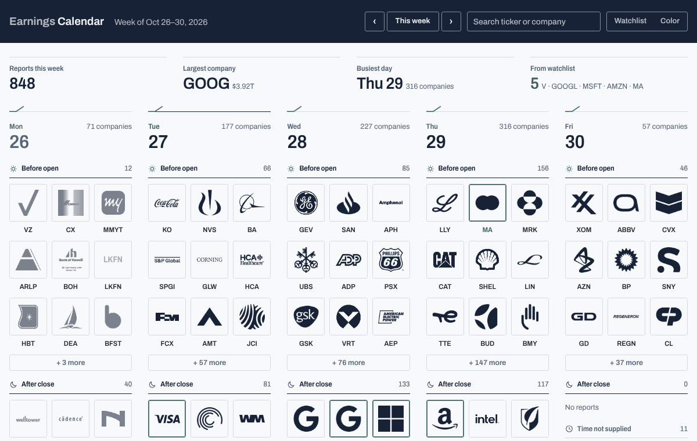
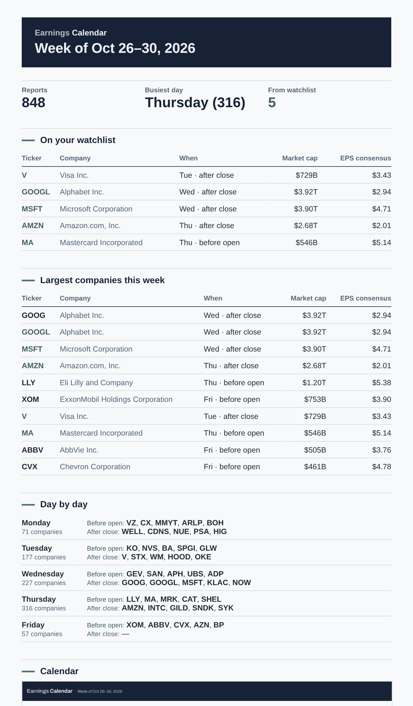
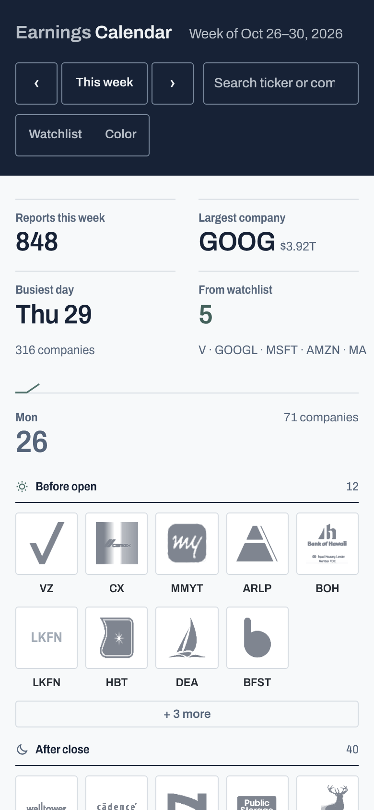
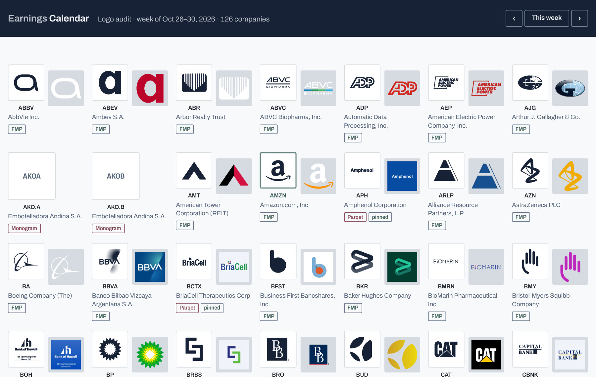

# Earnings Calendar

**A weekly calendar of US earnings reports shown as company logos, with a Sunday email that sums up the week ahead.**
Inspired by the [Yahoo Finance earnings calendar](https://finance.yahoo.com/calendar/earnings/), rebuilt in my own
design system and automated end to end: the data refreshes itself every weekday, and every Sunday a summary with a
screenshot of the coming week lands in my inbox.



## What it does

- **The week at a glance.** Five columns, Monday to Friday, each split into reports *before the open*, *after the
  close* and *time not supplied*. The nine largest companies by market cap lead each session; the rest open
  with "+ N more". A busy week runs to 800+ reports, so the ranking is what keeps the page readable.
- **The numbers behind each logo.** Click a company for market cap, EPS consensus, EPS a year ago, the change
  year on year, the fiscal quarter and the number of analyst estimates.
- **A watchlist.** My companies are outlined in the accent colour, counted in the summary row, and one click
  filters the week down to them. Search works by ticker or company name.
- **The Sunday email.** Reports for the week, the busiest day, my watchlist companies with their dates and
  sessions, the ten largest companies, a day-by-day overview and a screenshot of the calendar.
- **Honest about its data.** A notice appears when the data is more than a day old, and on weeks far enough ahead
  that Nasdaq's dates are still estimates. "Today" follows New York time, the time zone the report dates are in.

| The Sunday email | On a phone |
| --- | --- |
|  |  |

## What this project shows

- **Automation from source to inbox.** Three GitHub Actions workflows run the product with no server to keep:
  a weekday data refresh that commits the new data, a Sunday job that screenshots the app in a headless browser
  and emails the summary over SMTP, and CI that tests every change. Pages publishing is one switch away.
- **Working with imperfect data.** The data comes from Nasdaq's public calendar API, which has no key and no
  contract. The fetch retries with backoff, keeps a day's previous data when Nasdaq answers with an empty day,
  and stores one company per line so each day's data commit stays small and readable.
- **Data quality as a habit.** Logos are matched by ticker, so a provider can return another company's mark, a
  rebrand's old logo or a promo banner. I audited all 540 logos the app shows by default, company by company,
  and pinned 37 of them to a better source or a monogram (`docs/logo-audit.md`). An `?audit` view shows each
  logo of a week next to the brand's original, so new companies can be checked in one scan.
- **One visual language for 4,300 brands.** `scripts/logos.mjs` redraws every company's logo as a single navy
  mark, so a week of 40 logos reads as one page in the app's colours. It works out what is mark and what is
  background: white lettering on transparency is kept, a coloured square behind white letters is dropped,
  symbols cut into a badge stay cut out, and every mark is cropped to the same margin. The marks are built
  once and committed (11 MB for 4,250 companies); the daily refresh draws only new tickers. The brand's
  original colours come back on hover or with one toggle.
- **Design.** The same design system as my [Option Toolkit](https://github.com/z0zqa/opcje): a midnight-navy band,
  rules instead of cards, eucalyptus as the only accent, one typeface (Archivo) with tabular figures, and a dark
  theme that follows the system setting.
- **Accessibility.** Every label meets WCAG AA contrast in both themes (axe-core reports no violations), the app
  works from the keyboard, company details take and return focus, and the layout holds on a phone.
- **Verification.** 13 automated tests: unit tests for the data parsing, date logic, storage format and logo drawing, and
  browser tests that load the app in Chromium and check rendering, bad links, search, the watchlist filter,
  keyboard use, the New York "today" and the data notices. The tests for each bug I fixed were checked to fail
  on the code before the fix. The email was sent end to end through a test SMTP server before going live.
- **Reviewing my own work.** After the first release I audited the app as a whole: data freshness, bugs,
  security, accessibility, dependencies and the workflows. Every finding was fixed and the bugs among them are
  now covered by tests; the biggest was stale data that showed 18 large companies on the wrong day.

## How it works

```
Nasdaq calendar API ──► scripts/fetch.mjs ──► data/earnings.js ──► index.html + app.js (the calendar)
   (weekdays, 05:23 UTC)                                                  │
                                                                          ▼
                       scripts/digest.mjs (Sundays, 16:07 UTC): headless Chromium screenshot ──► email over SMTP
```

- **No build step, no framework.** `index.html`, `app.js` and `styles.css` are the whole app, under 1,200 lines
  with the scripts and tests. The data ships as a script file, so the page opens straight from disk.
- **Logos** are drawn ahead of time by `scripts/logos.mjs` from Financial Modeling Prep, then Parqet, into
  `logos/` (one navy PNG per ticker, plus an index of where each came from); a ticker with no usable logo gets a
  monogram. Overrides live in `config.json`.
- **Data window:** one week back and three weeks ahead, refreshed daily; eight weeks of history are kept.

| Logo audit view (`index.html?audit`) |
| --- |
|  |

## Run it

```bash
npm install
npm run fetch        # one week back + three weeks ahead into data/
npm run logos        # draws navy marks for new tickers into logos/ (--force redraws all)
open index.html      # or: npm start → http://localhost:4321
npm test             # unit tests + the app in headless Chromium
npm run digest:dry   # builds the email and the screenshot into out/ without sending
npm run record:tour  # re-records docs/tour.gif
```

### The Sunday email

The **Sunday email** workflow runs on Sundays at 16:07 UTC. It needs two repository secrets (Settings → Secrets
and variables → Actions):

| Secret | Value |
| --- | --- |
| `SMTP_USER` | the Gmail address that sends the email |
| `SMTP_PASS` | a [Google app password](https://myaccount.google.com/apppasswords) (needs 2-step verification) |
| `MAIL_TO` | the recipient (optional; defaults to `SMTP_USER`) |

Optional variables: `APP_URL` adds an "Open the app" link; `SMTP_HOST` / `SMTP_PORT` for a server other than
Gmail. To try it: **Actions → Sunday email → Run workflow**; "Build the email only" leaves the email and
screenshot in the run's `digest` artifact, along with the logo audit sheet for that week.

### Configuration (`config.json`)

| Field | Meaning |
| --- | --- |
| `watchlist` | tickers highlighted in the app and listed in the email |
| `perSession` | logos per session before "+ N more" |
| `weeksBack`, `weeksAhead`, `keepWeeks` | how much data to fetch and keep |
| `logoOverrides` | `"parqet"`, `"none"` (monogram) or an image URL for a ticker whose logo is wrong |

Run `npm run fetch` after a change (it regenerates `config.js` for the browser), and `npm run logos` after
changing `logoOverrides`.

### Publishing (optional)

`pages.yml` deploys the app to GitHub Pages after each successful data refresh. Turn on Pages (Source: GitHub
Actions) and set the repository variable `PAGES_ENABLED=true`. On a private repository Pages needs GitHub Pro.

## Limits

- Dates more than a week or two out are Nasdaq's estimates and often move; the app says so on those weeks.
- The Nasdaq API and both logo sources are public endpoints without a service agreement. If one changes, the
  refresh fails visibly (GitHub emails the failed run) or logos fall back to monograms; nothing breaks silently.
- Logos are company trademarks, shown here for personal use.
